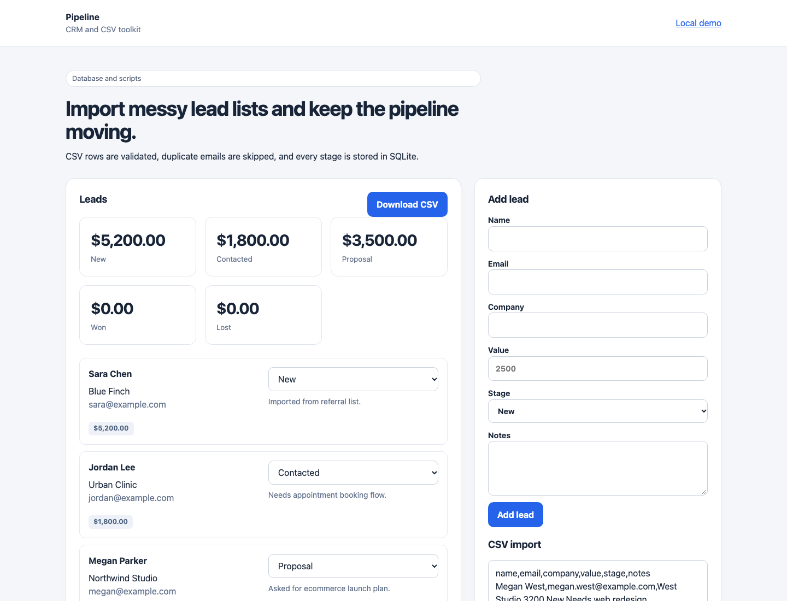

# Pipeline



Pipeline is a compact CRM and CSV toolkit. It tracks leads by stage, validates imported CSV rows, skips existing emails, exports clean CSV, and includes command-line utilities for import/export.

## Run

```sh
python3 server.py
```

Open `http://127.0.0.1:8104`.

## CLI examples

```sh
python3 import_leads.py leads.csv
python3 export_leads.py > leads-export.csv
```

## What it demonstrates

- CRM-style lead management
- CSV parsing with validation
- Duplicate email handling
- SQLite persistence
- Small automation scripts for business data

## Test

```sh
python3 -m unittest discover -s tests -v
```

This is a local single-user CRM demo. It does not include authentication or team permissions.
